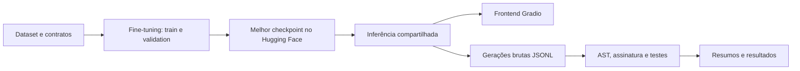

# Mini Code LLM

Fine-tuning supervisionado do **HuggingFaceTB/SmolLM2-135M** para transformar instruções em inglês em pequenas funções Python. O projeto reúne dataset, contratos comportamentais, baseline, três experimentos, avaliação objetiva e interface Gradio.

**Para executar no Windows:** com Python 3.11 instalado, baixe e extraia o projeto e dê dois cliques em **[iniciar.bat](iniciar.bat)**. Ele prepara o ambiente e abre o frontend automaticamente.

**Origem dos experimentos:** todo o trabalho experimental original — baseline, treinamento dos três experimentos, validações e teste final — foi executado na instância Linux com **RTX 4090 de 24 GB e CUDA 13.0**. Esta pasta é uma cópia do projeto trazida da instância para organização, documentação e preparação da entrega. As verificações técnicas posteriores desta cópia local são registradas separadamente.

**Resultado histórico:** 76/120 tarefas corretas no baseline de validation (**63,3%**); 120/120 no teste final do experimento 3 (**100%**). São conjuntos diferentes: a comparação direta entre configurações usa validation. O teste final confirma o desempenho nas famílias conhecidas e não mede programação geral.

[Modelos publicados no Hugging Face](https://huggingface.co/laia020/mini-code-llm) · [Roteiro da apresentação](docs/presentation.md) · [Relatório da implementação](docs/implementation-report.md)

## Objetivo acadêmico e evidências

Demonstrar que uma LLM compacta pré-treinada pode ser especializada por supervised fine-tuning (SFT), comparando parâmetros de treinamento e avaliando o comportamento do código gerado.

| Requisito | Implementação ou evidência | Situação |
|---|---|---|
| 1. Escolher uma LLM | SmolLM2-135M, aproximadamente 135 milhões de parâmetros | Implementado |
| 2. Escolher um problema | Geração de funções Python em 12 famílias | Implementado |
| 3. Testar parâmetros | Três configurações de learning rate, batch e epochs | Resultados preservados |
| 4. Avaliar respostas | AST, assinatura e testes de `contracts/families.json` | Implementado |
| 5. Usar GPU | Treinamento em RTX 4090 24 GB com PyTorch `2.13.0+cu130` e CUDA 13.0, confirmado pelo autor; log registra `Device: cuda` | Realizado; evidência visual será entregue pelo autor em documento separado |
| 6. Criar frontend | Gradio em `src/app.py` | Implementado; ver verificações no relatório |
| 7. Print da GPU no VS Code | Screenshot original da instância, mostrando o VS Code e a GPU | Entrega em documento separado pelo autor |
| 8. Código e documentação no GitHub | Repositório pessoal `laia020/mini-code-llm`, pesos no Hugging Face | Código, dados, resultados e documentação versionados neste repositório |

O modelo **não foi treinado do zero**. Foi realizado **full supervised fine-tuning**: todos os pesos do modelo pré-treinado são ajustados. Não foram usados LoRA ou quantização no protocolo histórico.

## Problema e exemplo

O usuário escreve apenas:

```text
Create a function that checks whether a number is even.
```

O sistema monta internamente o prompt, incluindo a quebra de linha final:

```text
### Task:
Create a function that checks whether a number is even.

### Code:
```

Uma resposta desejada é:

```python
def is_even(number):
    return number % 2 == 0
```

O objetivo é melhorar a correção funcional, a aderência aos nomes e parâmetros e o encerramento da resposta, evitando explicações, conclusões e Markdown adicional. As instruções e os identificadores do dataset estão em inglês.

## Dataset e contratos

O dataset sintético possui **960 registros**. Cada família contém 60 exemplos de train, 10 de validation e 10 de test.

| Dificuldade | Famílias e assinaturas |
|---|---|
| 1 | `add_numbers(a, b)`, `is_even(number)`, `get_largest(a, b)`, `reverse_string(text)` |
| 2 | `calculate_average(numbers)`, `count_vowels(text)`, `get_min_max(numbers)`, `is_palindrome(text)`, `get_even_numbers(numbers)` |
| 3 | `count_occurrences(items, target)`, `remove_duplicates(items)`, `word_frequency(words)` |

| Divisão | Exemplos | Uso |
|---|---:|---|
| Train | 720 | Atualizar os pesos |
| Validation | 120 | Acompanhar loss, comparar configurações e selecionar o modelo |
| Test | 120 | Avaliação final após a seleção; conjunto congelado |

Cada JSONL contém `id`, `family`, `difficulty`, `instruction`, `prompt`, `code` e `text`. Os contratos definem assinatura, restrições, implementação canônica e casos comportamentais, incluindo entradas vazias e tipos de retorno quando exigidos. Existem **53 casos contratuais**, repetidos por família nos exemplos de cada split: **530 verificações** em validation e em test.

As instruções normalizadas não se repetem entre divisões. Entretanto, as famílias, assinaturas e códigos canônicos são compartilhados: há apenas 12 implementações alvo. Isso limita as conclusões a reformulações de tarefas conhecidas. Os hashes em `data/manifest.json` e `docs/original-artifacts.json` permitem verificar integridade.

## Como funciona o fine-tuning

O SmolLM2 é um **Causal Language Model**: usa os tokens anteriores para prever o próximo token. A tokenização converte texto em IDs; os **logits** são os escores do modelo para os próximos tokens. Na geração autoregressiva, cada token produzido entra no contexto do seguinte.

No SFT, prompt e código são concatenados:

```text
input_ids: [tokens do prompt] [tokens do código] [EOS]
labels:    [-100 ... -100]   [tokens do código] [EOS]
```

- **Labels e masking:** o valor `-100` faz a loss ignorar os tokens do prompt. O modelo continua vendo o prompt como contexto. O deslocamento causal de labels é feito internamente pelo modelo.
- **EOS:** token supervisionado que ensina o término da resposta. Entradas longas são rejeitadas antes do treinamento para evitar removê-lo silenciosamente.
- **Batch e padding:** o batch agrupa exemplos; sequências menores recebem padding. Os labels do padding são `-100` e a attention mask recebe zero nessas posições. Mesmo quando PAD usa o ID de EOS, o EOS real continua supervisionado.
- **Loss:** entropia cruzada sobre os próximos tokens supervisionados. Menor loss indica melhor previsão desses tokens, mas não substitui testes funcionais. O protocolo calcula a média das losses dos batches de validation.
- **AdamW:** atualiza os pesos usando estimativas adaptativas dos gradientes e weight decay desacoplado. O código usa weight decay padrão de 0,01 e gradient clipping com norma máxima 1,0.
- **Learning rate:** tamanho dos ajustes dos pesos. **Epoch:** uma passagem pelo treino. Os experimentos completos usaram comprimento máximo de 256 tokens.

O checkpoint de cada execução é salvo quando apresenta a menor validation loss. O test set não participa da seleção.

## Resultados históricos

### Comparação em validation

| Configuração | LR | Batch | Epochs | Melhor val loss | Tarefas corretas |
|---|---:|---:|---:|---:|---:|
| Base | — | — | — | — | 76/120 (63,3%) |
| Experimento 1 | 5e-5 | 2 | 5 | 0,0010¹ | 120/120 (100%) |
| Experimento 2 | 1e-5 | 1 | 3 | 0,0901¹ | 82/120 (68,3%) |
| **Experimento 3** | **1e-4** | **2** | **5** | **0,0005²** | **120/120 (100%)** |

¹ Loss e configuração informadas pelo autor; os logs de treinamento dos experimentos 1 e 2 não estão nesta cópia. As métricas funcionais possuem arquivos de resultados. ² Loss arredondada registrada em `results/experiment_3_train.log`; configuração presente no treinamento original. O log não permite recuperar maior precisão.

| Métrica | Base | Exp. 1 | Exp. 2 | Exp. 3 |
|---|---:|---:|---:|---:|
| Python válido | 118/120 (98,3%) | 100% | 100% | 100% |
| Assinatura correta | 117/120 (97,5%) | 100% | 100% | 100% |
| Tasks passed | 76/120 (63,3%) | 100% | 82/120 (68,3%) | 100% |
| Unit tests | 354/530 (66,8%) | 530/530 | 381/530 (71,9%) | 530/530 |
| Exact match | 38/120 (31,7%) | 100% | 71/120 (59,2%) | 100% |
| Code-only output | 0/120 (0%) | 100% | 119/120 (99,2%) | 100% |

| Dificuldade | Base: tasks passed | Exp. 2: tasks passed | Exp. 3: tasks passed |
|---|---:|---:|---:|
| 1 | 92,5% | 100% | 100% |
| 2 | 56,0% | 80,0% | 100% |
| 3 | 36,7% | 6,7% | 100% |

### Interpretação dos experimentos e escolha do modelo

**Baseline.** A avaliação inicial estabeleceu quanto o modelo pré-treinado já resolvia antes da especialização. Em 98,3% das respostas, o código extraído era sintaticamente válido, mas apenas 63,3% das tarefas passavam em todos os testes. Portanto, a sintaxe não era a principal dificuldade: lógica, aderência ao contrato e formato também precisavam melhorar. Entre as famílias com menor desempenho estavam:

| Família | Tarefas corretas no baseline de validation |
|---|---:|
| `count_vowels` | 0/10 (0%) |
| `get_min_max` | 2/10 (20%) |
| `remove_duplicates` | 0/10 (0%) |
| `word_frequency` | 1/10 (10%) |

As respostas brutas preservadas em `results/baseline_validation.jsonl` incluem seções como `### Explanation` e `### Conclusion`, exemplos adicionais e explicações que nem sempre correspondem à implementação. Por exemplo, a primeira resposta implementa uma soma direta, mas a explicação descreve verificações de tipos inexistentes no código. Nenhuma das 120 respostas do baseline atendia à métrica code-only.

**Experimento 1.** Com LR `5e-5`, batch 2 e cinco epochs, atingiu 120/120 tarefas, 530/530 verificações e 100% de code-only em validation. Isso demonstra melhora funcional e aderência ao formato nas tarefas avaliadas. A melhor validation loss de 0,0010 foi informada pelo autor; seu log não está nesta cópia.

**Experimento 2.** Com LR `1e-5`, batch 1 e três epochs, atingiu 99,2% de code-only, mas apenas 68,3% de tarefas corretas. Na dificuldade 3, o acerto foi de 6,7%; `count_occurrences` atingiu 20%, enquanto `count_vowels`, `remove_duplicates` e `word_frequency` ficaram em 0%. O resultado mostra que seguir o formato e implementar o comportamento correto são dimensões diferentes: uma resposta pode conter somente Python válido e ainda falhar nos contratos. Como LR, batch e epochs mudaram juntos em relação ao experimento 1, não é possível atribuir o desempenho a apenas um fator. A configuração combinada não atingiu a especialização funcional observada nos outros dois experimentos.

**Experimento 3.** Nos hiperparâmetros declarados, manteve batch 2, cinco epochs e comprimento máximo 256 do experimento 1, alterando o LR de `5e-5` para `1e-4`. Também atingiu 120/120 tarefas e 530/530 verificações, com exact match e code-only de 100%. Sua melhor validation loss registrada foi 0,0005, contra 0,0010 informada para o experimento 1. A comparação não inclui repetições com várias seeds, portanto não estabelece que aumentar o LR sempre melhora o resultado.

**Escolha final.** O experimento 3 foi selecionado exclusivamente com validation, antes da avaliação final em test, segundo o protocolo informado pelo autor. Como os experimentos 1 e 3 empataram nas métricas funcionais, a menor validation loss foi o critério de desempate. O benchmark não demonstrou superioridade funcional do experimento 3 sobre o experimento 1; ambos acertaram todas as tarefas de validation.

### Teste final

Segundo o protocolo informado pelo autor, o experimento 3 foi avaliado uma única vez no conjunto final após a escolha.

| Métrica | Resultado |
|---|---:|
| Python válido | 120/120 (100%) |
| Assinatura correta | 120/120 (100%) |
| Tasks passed | 120/120 (100%) |
| Unit tests | 530/530 (100%) |
| Exact match | 120/120 (100%) |
| Code-only output | 120/120 (100%) |
| Dificuldades 1 / 2 / 3 | 40/40 · 50/50 · 30/30 |

Todas as 12 famílias obtiveram 100%. As fontes são os arquivos `*_summary.json`, os JSONL detalhados e as gerações brutas de `results/`. `finetuned_validation*` corresponde ao experimento 1. A auditoria posterior reexecuta testes sobre respostas salvas; ela não realiza outra inferência no test set nem ajusta o modelo.

## Avaliação objetiva

A métrica principal é **Tasks passed**: uma tarefa só passa quando todos os seus casos comportamentais passam. O avaliador extrai o código, analisa AST e sintaxe, verifica nome e parâmetros, aplica restrições de execução e roda os contratos em subprocesso, com timeout padrão de cinco segundos por exemplo.

Exact match compara o código extraído ao alvo canônico e é secundário: implementações textualmente diferentes podem ter o mesmo comportamento. Code-only compara a resposta bruta ao código extraído. A limpeza visual do frontend nunca é usada para melhorar as métricas.

As restrições de AST, built-ins e subprocesso servem ao experimento controlado; **não são um sandbox geral** para código arbitrário. O frontend exibe a saída e não oferece execução de código.

## Como executar após baixar

1. Instale **Python 3.11**, caso ainda não tenha.
2. Baixe o repositório e extraia o ZIP, se necessário.
3. No **Windows**, dê dois cliques em **[`iniciar.bat`](iniciar.bat)**.

O inicializador cria a `.venv`, instala as dependências e abre o frontend no navegador. Não é preciso ativar o ambiente ou executar comandos de instalação. Mantenha a janela do inicializador aberta enquanto usa o aplicativo.

Na primeira execução, a instalação pode demorar e requer internet. O modelo é baixado automaticamente no primeiro Generate. Nas próximas execuções, o ambiente e as dependências já preparados são reutilizados. Para encerrar, pressione **Ctrl+C** na janela do inicializador.

No **Linux/macOS**, com Python 3.11 instalado, basta executar:

```bash
python3.11 iniciar.py
```

O instalador usa PyTorch CPU em novos ambientes Windows/Linux, suficiente para demonstrar o modelo. Uma instalação existente e compatível de PyTorch CUDA é preservada.

<details>
<summary>Instalação manual e uso de GPU (opcional)</summary>

Execute os comandos a partir da raiz do projeto:

```powershell
python -m venv .venv
.\.venv\Scripts\Activate.ps1
python -m pip install -r requirements.txt
```

No Linux/macOS, ative com `source .venv/bin/activate`. Se a política do PowerShell impedir ativação, execute diretamente `.\.venv\Scripts\python.exe` no lugar de `python`.

Para GPU, instale primeiro a distribuição CUDA do PyTorch compatível com o driver usando o comando do [seletor oficial do PyTorch](https://pytorch.org/get-started/locally/), depois os requirements. Confirme:

```powershell
python -c "import torch; print(torch.__version__); print(torch.cuda.is_available()); print(torch.cuda.get_device_name(0) if torch.cuda.is_available() else 'CPU')"
```

Há somente quatro dependências diretas: `torch`, `transformers`, `gradio` e `huggingface_hub`. Não é necessário Accelerate: o código usa um único dispositivo com `.to(device)`. Transformers está fixado em **5.19.0**, versão registrada nos artefatos publicados: a versão 4.57.6 falhou com o formato de `extra_special_tokens` do tokenizer. Gradio permanece na API 5; as versões efetivamente testadas constam no relatório. O primeiro uso baixa os pesos para o cache do Hugging Face fora do Git.

</details>

## Frontend e inferência

O inicializador abre `http://127.0.0.1:7860` automaticamente. Escreva somente a instrução, clique em **Generate** e use **Clear** para limpar. Há seis prompts prontos em duas fileiras de três botões e uma explicação expansível das 12 famílias. O modelo é carregado na primeira geração e reutilizado. CUDA é escolhida quando disponível; caso contrário, CPU. Não é criado link público.

Com o ambiente já configurado, a execução direta `python src/app.py` também continua disponível. Para inferência individual pelo terminal:

```powershell
python src/inference.py "Create a function that checks whether a number is even."
python src/inference.py "Create count_vowels(text) that counts vowels case-insensitively." --device cpu
```

Inferência usa geração determinística (`do_sample=False`) com até 128 novos tokens. O prompt é removido por comprimento de tokens; a apresentação extrai a primeira função, sem modificar a resposta bruta usada no benchmark.

## Modelos no Hugging Face

O repositório contém `experiment-1`, `experiment-2` e **`experiment-3`**, o escolhido. Cada subpasta contém configuração, pesos e tokenizer. O projeto fixa a revisão verificada para evitar mudanças silenciosas; a CLI permite `--revision main` ou outro commit.

```python
from transformers import AutoModelForCausalLM, AutoTokenizer

repo_id = "laia020/mini-code-llm"
options = {
    "subfolder": "experiment-3",
    "revision": "044a7de4030020a593eedb2417d11aecd38e5268",
    "token": False,
}
tokenizer = AutoTokenizer.from_pretrained(repo_id, **options)
model = AutoModelForCausalLM.from_pretrained(repo_id, **options)
```

O acesso público não exige login. Não coloque tokens no código. Para administrar sua própria conta, a autenticação da ferramenta Hub pode ser feita separadamente com `hf auth login` e verificada com `hf auth whoami`; ela não é necessária para este aplicativo. Os pesos não devem ser adicionados ao GitHub.

Se o primeiro download ficar parado no transporte Xet da rede local, feche a tentativa e experimente o transporte HTTP padrão antes de iniciar novamente:

```powershell
$env:HF_HUB_DISABLE_XET = "1"
python src/app.py
```

No Linux, use `HF_HUB_DISABLE_XET=1 python src/app.py`. Isso altera somente o transporte de download; mantém a origem pública e a revisão do modelo. O cache pode ser aquecido antes da apresentação. Em Windows sem suporte a symlinks, o Hub pode emitir um aviso e ocupar mais espaço, sem exigir execução como administrador.

## Treinamento e reprodução

Exemplo de **nova execução**, preferencialmente em GPU:

```powershell
python src/train.py --experiment experiment-3 --output-dir models/experiment-3-new --device cuda
```

Troque `--experiment` por `experiment-1` ou `experiment-2`. É possível fornecer `--learning-rate`, `--batch-size`, `--epochs`, `--seed`, `--max-length`, `--train-file` e `--validation-file`. Sem `--device cuda`, há seleção automática e fallback para CPU, que pode ser lento.

As novas execuções registram configuração, seed padrão 42, versões, dispositivo, losses e melhor epoch em `training_metadata.json`. A seed 42 não é atribuída aos experimentos históricos. O autor confirmou PyTorch `2.13.0+cu130` e CUDA 13.0 no ambiente de treinamento; a seed e o ambiente histórico completo não estão registrados, portanto não se promete reprodução bit a bit.

Gere respostas de validation e avalie em caminhos novos:

```powershell
python src/generate.py --model laia020/mini-code-llm --subfolder experiment-3 --input data/validation.jsonl --output results/reproductions/exp3_validation.jsonl
python src/evaluate.py --input results/reproductions/exp3_validation.jsonl --output results/reproductions/exp3_evaluated.jsonl --summary results/reproductions/exp3_summary.json
```

Para baseline, use `--model HuggingFaceTB/SmolLM2-135M`, sem subfolder. Para um novo checkpoint local, use `--model models/experiment-3-new`. O gerador salva a resposta bruta e um arquivo separado de metadados.

Os nomes antigos continuam como atalhos, por exemplo `python src/evaluate_experiment_3.py`; suas saídas agora ficam em `results/reproductions/`. Os comandos recusam arquivos/diretórios de saída já existentes. Escolha outro nome para repetir. `final_test.py` continua disponível para reprodução explícita, mas não faz parte dos testes rotineiros e não deve ser usado para selecionar hiperparâmetros.

## Verificação

```powershell
python -m compileall -q src scripts tests
python -m unittest discover -s tests -v
python scripts/validate_dataset.py
python scripts/audit_results.py --output-dir results/verification/audit-new
python scripts/smoke_test.py --output results/verification/runtime-new.json
python scripts/verify_repository.py
```

A auditoria usa as 600 gerações históricas salvas e compara resumos e detalhes. O smoke test online verifica três instruções independentes dos arquivos de test, inferência real em CPU, CUDA quando disponível, HTTP e callbacks do Gradio e um passo de treinamento em checkpoint temporário. Esse passo parte do experimento 3 publicado e só verifica o funcionamento do pipeline; não representa outro experimento acadêmico.

Para reconstruir o dataset em uma pasta separada, sem tocar no benchmark congelado:

```powershell
python scripts/build_dataset.py --output-root results/reproductions/dataset-copy
python scripts/validate_dataset.py --root results/reproductions/dataset-copy
```

Os scripts educacionais continuam disponíveis: `inspect_training_example.py`, `inspect_batch.py`, `inspect_loss.py` e `baseline_single.py`. Eles demonstram labels, padding, logits e previsão do próximo token; execute-os explicitamente a partir da raiz.

## GPU e screenshots

O baseline, os três treinamentos, as validações e o teste final foram realizados na instância Linux com **NVIDIA GeForce RTX 4090, 24 GB**, acessada pelo VS Code via SSH. O autor confirmou o seguinte ambiente experimental:

| Informação | Valor informado |
|---|---|
| GPU | NVIDIA GeForce RTX 4090 |
| VRAM | 24 GB |
| `CUDA Version` exibida por `nvidia-smi` | `13.0` |
| `torch.__version__` | `2.13.0+cu130` |
| `torch.version.cuda` | `13.0` |
| `torch.cuda.is_available()` | `True` |

O log preservado também registra `Device: cuda`. Esses dados descrevem a instância de treinamento, conforme confirmado pelo autor. A finalização e os smoke tests posteriores foram executados em outra máquina, com PyTorch CPU; a indisponibilidade de CUDA nessa verificação local não se refere ao treinamento original.

O print original deve mostrar o VS Code e o resultado real de `nvidia-smi`, acompanhado idealmente das informações CUDA do PyTorch acima.

O autor entregará os screenshots ao professor em um **documento separado**. O print da GPU deve mostrar a janela do VS Code para atender ao requisito acadêmico. Cópias das imagens também podem ser incluídas opcionalmente em `docs/images/`; consulte [as instruções das imagens](docs/images/README.md). Não foram fabricadas imagens; a GPU histórica não deve ser confundida com o hardware da máquina usada para finalizar o projeto.

## Estrutura



```text
contracts/                  contratos e testes comportamentais
data/                       splits congelados e manifest
docs/                       apresentação, relatório, hashes e imagens
results/                    resultados históricos preservados
  reproductions/            novas execuções locais, ignoradas pelo Git
  verification/             verificações locais, ignoradas pelo Git
scripts/                    construção, validação, auditoria e smoke test
src/                        frontend, inferência, geração, treinamento e avaliação
tests/                      testes unitários e regressões
.gitignore                  exclusão de pesos, caches e segredos
requirements.txt            dependências diretas
iniciar.bat                 inicializador com dois cliques no Windows
iniciar.py                  preparação automática e abertura do frontend
```

## Limitações e próximos passos

- Excelente especialização nas famílias conhecidas não implica resolver problemas Python novos. As formulações são sintéticas e compartilham alvos e assinaturas.
- A avaliação cobre os casos contratuais existentes, não todos os comportamentos possíveis. Exact match de 100% é compatível com memorização das 12 implementações.
- O estudo não isola o efeito de cada hiperparâmetro e não possui repetições com várias seeds ou estimativa de variabilidade.
- Entradas em português, novas assinaturas e tarefas fora das famílias não foram validadas.
- Na verificação da CLI, a instrução genérica sobre paridade, sem assinatura, retornou `isEven(number)` em vez do identificador canônico `is_even(number)`. Informe a assinatura desejada; aderência ao nome não é garantida quando ele fica implícito.
- Próximos passos: mais diversidade de implementações e linguagem, famílias inéditas em um benchmark separado, contratos ampliados e experimentos controlados com múltiplas seeds. O test set atual permanece congelado.

